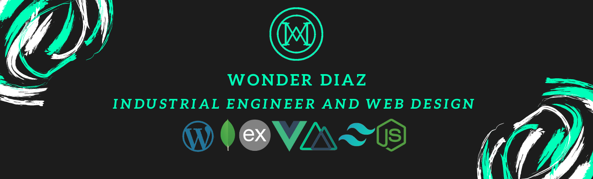

Hi there, I'm Wonder Diaz! 👋

<b>Industrial Engineer & Passionate Software Developer</b>

I love exploring new technologies and building innovative solutions. With several years of experience in the industry, I have worked on a variety of projects ranging from web applications to multiplatform apps.

<!-- Portfolio Button Badge -->

 

🛠️ Tech Stack & Skills

  
  
  
  
  
  
  
  
  
  
  
  
  
  
  
  
  
  
  
  
  
  
  
  
  
  
  

 

📂 Featured Projects

Here are some of my recent projects presented as cards:

<table>
<tr>
<td width="50%">
<a href="https://github.com/MetalSyntax/PARITY">
<h3>💰 PARITY</h3>
</a>

An application designed to help you manage your personal finances in a simple, secure, and efficient way.

</td>
<td width="50%">
<a href="https://github.com/MetalSyntax/VITREON">
<h3>📝 VITREON</h3>
</a>

A notes app with a 'Deep Glass' design and neural assistance that organizes your thoughts as you write.

</td>
</tr>
<tr>
<td width="50%">
<a href="https://github.com/MetalSyntax/FLUX">
<h3>📖 FLUX</h3>
</a>

A minimalist and elegant universal book reader with a modern, clean interface

</td>
<td width="50%">
<a href="https://github.com/MetalSyntax/BeBrief-Studio">
<h3>🎨 BeBrief-Studio</h3>
</a>

Workspace and visual editor designed for designers to structure, customize, and prototype case study briefs for Behance.

</td>
</tr>
<tr>
<td width="50%">
<a href="https://github.com/MetalSyntax/NAVE">
<h3>🏍️ NAVE</h3>
</a>

A high-performance motorcycle diagnostics & maintenance tracker.

</td>
<td width="50%">
<a href="https://github.com/MetalSyntax/CV-Builder">
<h3>📄 VITAE</h3>
</a>

ATS-optimized resume builder replicating a specific design with color customization and PDF export capabilities.

</td>
</tr>
<tr>
<td width="50%">
<a href="https://github.com/MetalSyntax/Webflow-Auditor">
<h3>🔍 Webflow-Auditor</h3>
</a>

Webflow Extension Auditor SEO Performance A11Y.

</td>
</tr>
<tr>
</td>
</tr>
</table>

📈 GitHub Stats

🤝 Follow Me and Contact

Connect with me on the following social networks:

&nbsp;&nbsp;&nbsp;

&nbsp;&nbsp;&nbsp;

"Der Weg Einer Freiheit und Solve Et Coagula."

