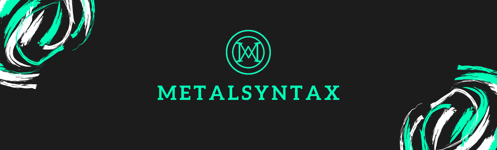

Hi there, I'm Wonder Diaz! 👋

<b>Industrial Engineer, Systems & Full Stack Software Developer</b>

Specialized in building modern, high-performance web and multiplatform applications as well as low-level systems engineering, game porting (soloader wrappers, ARMv7, JNI emulation), and reverse engineering for platforms like the PlayStation Vita.

<!-- Portfolio Button Badge -->

&nbsp;

  

## 🛠️ Tech Stack & Skills

### 🎮 Low-Level, Systems & Game Porting

  
  
  
  
  
  
  
  
  

### 🌐 Modern Web & Cross-Platform

  
  
  
  
  
  
  
  
  
  
  
  

### 🗄️ Tooling, Databases & Design

  
  
  
  
  

 

## 🎮 PS Vita Ports & Systems Engineering

<table>
<tr>
<td width="50%">
<a href="https://github.com/MetalSyntax/Asphalt-5-Vita">
<h3>🏎️ Asphalt 5</h3>
</a>

Native PS Vita wrapper and port of Gameloft's classic arcade racing game, built on soloader-boilerplate with custom shaders and controls.

</td>
<td width="50%">
<a href="https://github.com/MetalSyntax/zenonia3-psvita-port">
<h3>⚔️ Zenonia 3</h3>
</a>

Native PS Vita port/wrapper of Gamevil's acclaimed ARPG, running original ARMv7 code with physical Vita control mappings.

</td>
</tr>
<tr>
<td width="50%">
<a href="https://github.com/MetalSyntax/Shadow-Guardian-vita">
<h3>🗡️ Shadow Guardian HD</h3>
</a>

Android to PS Vita native port of Gameloft's action-adventure title, bringing full hardware-accelerated 3D graphics to the handheld.

</td>
<td width="50%">
<a href="https://github.com/MetalSyntax/prince-of-persia-classic-psvita-port">
<h3>🏰 Prince of Persia Classic</h3>
</a>

PS Vita homebrew port and wrapper for Ubisoft's Prince of Persia Classic Android build with smooth native performance.

</td>
</tr>
<tr>
<td width="50%">
<a href="https://github.com/MetalSyntax/Dungeon-Hunter-2-vita">
<h3>🛡️ Dungeon Hunter 2</h3>
</a>

Dungeon Hunter 2 native port for PS Vita via so-loader, featuring full Vita controller integration and OpenGL ES translation.

</td>
<td width="50%">
<a href="https://github.com/MetalSyntax/Sacred-Odyssey-vita">
<h3>⚔️ Sacred Odyssey</h3>
</a>

Android to PS Vita native port of Gameloft's action-adventure RPG Sacred Odyssey: Rise of Ayden via soloader and vitaGL.

</td>
</tr>
<tr>
<td width="50%">
<a href="https://github.com/MetalSyntax/psvita-port-toolkit-cli">
<h3>🧰 PS Vita Port Toolkit CLI</h3>
</a>

Standalone TUI toolkit to port Android soloader games to PS Vita end-to-end: init, build, FTP deploy, crash dump analysis, and LiveArea assets.

</td>
<td width="50%">
<a href="https://github.com/MetalSyntax/DiskRecovery">
<h3>💾 DiskRecovery</h3>
</a>

High-performance macOS TUI for low-level disk recovery, sector sweeps, and bad sector reallocation built for drives that hang Disk Utility.

</td>
</tr>
</table>

 

## 🌐 Featured Web & Cross-Platform Projects

<table>
<tr>
<td width="50%">
<a href="https://github.com/MetalSyntax/PARITY">
<h3>💰 PARITY</h3>
</a>

Multiplatform personal finance management app designed to help you manage your money simply, securely, and efficiently.

</td>
<td width="50%">
<a href="https://github.com/MetalSyntax/VITREON">
<h3>📝 VITREON</h3>
</a>

Notes app with a 'Deep Glass' aesthetic and neural assistance that organizes your thoughts seamlessly as you write.

</td>
</tr>
<tr>
<td width="50%">
<a href="https://github.com/MetalSyntax/FLUX">
<h3>📖 FLUX</h3>
</a>

Minimalist and elegant universal book reader featuring a clean modern interface and offline-ready PWA architecture.

</td>
<td width="50%">
<a href="https://github.com/MetalSyntax/BeBrief-Studio">
<h3>🎨 BeBrief-Studio</h3>
</a>

Visual workspace and editor for designers to structure, customize, and prototype interactive case study briefs for Behance.

</td>
</tr>
<tr>
<td width="50%">
<a href="https://github.com/MetalSyntax/NAVE">
<h3>🏍️ NAVE</h3>
</a>

High-performance motorcycle diagnostics & maintenance tracker built with an Organic Brutalist UI, MapLibre routing, and offline PWA support.

</td>
<td width="50%">
<a href="https://github.com/MetalSyntax/VITAE">
<h3>📄 VITAE</h3>
</a>

ATS-optimized resume builder replicating precision layouts with real-time color customization and high-fidelity PDF export.

</td>
</tr>
<tr>
<td width="50%">
<a href="https://github.com/MetalSyntax/Webflow-Auditor">
<h3>🔍 Webflow-Auditor</h3>
</a>

Webflow Extension Auditor evaluating SEO, Core Web Vitals, performance bottlenecks, and accessibility (A11Y) compliance.

</td>
<td width="50%">
<a href="https://github.com/MetalSyntax/Shooter-Space-Phaser">
<h3>🚀 Shooter Space Phaser</h3>
</a>

Modernized, clean-code space arcade game with retro aesthetics, built using React, TypeScript, and Phaser 3 game engine.

</td>
</tr>
</table>

 

## 📈 GitHub Stats

 

## 🤝 Follow Me and Contact

Connect with me on the following networks:

&nbsp;&nbsp;&nbsp;

&nbsp;&nbsp;&nbsp;

  

_"Der Weg Einer Freiheit und Solve Et Coagula."_

